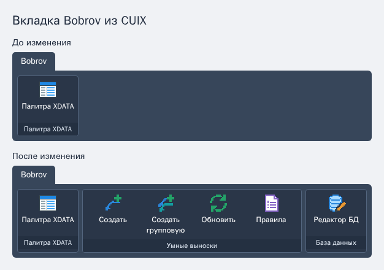

# ACadMenu

Меню и ribbon для моих модулей AutoCAD.

Модуль **BobrovMenu** добавляет вкладку **Bobrov** на ленту AutoCAD 2020 и новее (Windows x64).
AutoCAD загружает частичный `BobrovMenu.cuix` из пакета `BobrovMenu.bundle`. Макросы, панели
и значки входят в CUIX. Команды предоставляют отдельно установленные плагины.

| Панель Bobrov | Кнопка | Глобальная команда |
| --- | --- | --- |
| Палитра XDATA | Палитра XDATA | `_XDATAPALETTE` |
| Умные выноски | Создать | `_SL_CREATE` |
| Умные выноски | Создать групповую | `_SL_CREATE_GROUP` |
| Умные выноски | Обновить | `_SL_UPDATE` |
| Умные выноски | Правила | `_SL_RULES` |
| База данных | Редактор БД | `_DB_EDIT` |



**Палитра XDATA** также доступна через выпадающее меню **Bobrov** при `MENUBAR=1`. Она
показывает и скрывает палитру «Свойства XDATA». [ТЗ по палитре XDATA](menu-module-spec.md)

## Установка

Скачайте `BobrovMenu-manual-install-v<версия>.zip` из
[Releases](https://github.com/veb86/ACadMenu/releases) (или артефакт `BobrovMenu-release` сборки
CI), распакуйте и запустите `install.cmd`. Подробная инструкция по установке, обновлению и
удалению — [installer/manual/INSTALL.md](installer/manual/INSTALL.md).

Для кнопок установите совместимые с вашей версией AutoCAD
[acadPaletteSetXDATA](https://github.com/veb86/acadPaletteSetXDATA),
[ACadSmartLeader 0.1.4+](https://github.com/veb86/ACadSmartLeader/releases) и
плагин управления БД, предоставляющий `DB_EDIT`.

## Структура репозитория

| Путь | Назначение |
| --- | --- |
| `installer/BobrovMenu.bundle/` | шаблон пакета: `PackageContents.xml` и готовый `Contents/BobrovMenu.cuix` |
| `src/BobrovMenu.cuix/` | исходники CUIX — распакованные части (XML `.cui`, значки PNG), из которых собирается `BobrovMenu.cuix` |
| `installer/manual/` | `install.cmd`, `uninstall.cmd`, `INSTALL.md` архива ручной установки |
| `scripts/build_cuix.py` | собирает `BobrovMenu.cuix` из `src/BobrovMenu.cuix/`, проверяет (`--check`), распаковывает CUIX в исходники (`--unpack`) |
| `scripts/make_icons.py` | рисует значки 16×16 и 32×32 |
| `scripts/package.py` | собирает архив `BobrovMenu-manual-install-v<версия>.zip` |
| `tests/` | автоматические проверки (Python `unittest`) |
| `experiments/` | проверка `install.cmd`/`uninstall.cmd` в Windows, превью значков |
| `docs/acceptance-protocol.md` | протокол приёмки палитры XDATA |
| `docs/smartleader-menu-acceptance.md` | протокол приёмки кнопок выносок и БД |

Для сборки архива нужен Python 3.8+.

## Сборка и проверка

```bash
python3 scripts/make_icons.py --check     # значки совпадают с make_icons.py
python3 scripts/build_cuix.py --check     # BobrovMenu.cuix совпадает с src/BobrovMenu.cuix
python3 -m unittest discover -s tests -v  # структура CUIX, команда, меню, лента, пакет, архив
python3 scripts/package.py --version v0.2.0 --commit "$(git rev-parse HEAD)"  # artifacts/release/*.zip
```

CI (`.github/workflows/ci.yml`) выполняет эти проверки, проверяет установку и удаление архива в
Windows на временном `%APPDATA%`, а при push в `main` публикует релиз `v0.2.<номер сборки>`.

## Как изменить меню

**В редакторе CUI AutoCAD.** Откройте `installer/BobrovMenu.bundle/Contents/BobrovMenu.cuix`
командой `CUI` в AutoCAD 2020 (самой старой целевой версии), измените и сохраните, затем
синхронизируйте исходники:

```bash
python3 scripts/build_cuix.py --unpack installer/BobrovMenu.bundle/Contents/BobrovMenu.cuix
```

Если значки менялись в редакторе, перенесите изменения в `scripts/make_icons.py` (иначе
`make_icons.py --check` не пройдёт).

**В исходниках.** Измените файлы в `src/BobrovMenu.cuix/` (новые части и значки нужно указать в
`_rels/.rels` и `Menu_Package_Info.xml`, в последнем — обновить `PartData_Modified` изменённых
частей), затем пересоберите `python3 scripts/build_cuix.py` и закоммитьте и исходники, и
`BobrovMenu.cuix`.

Идентификаторы модуля: группа меню `BOBROVMENU`, команда `ID_BOBROV_XDATAPALETTE`, меню
`ID_BOBROV_POPMENU` (псевдонимы `POP1`, `BOBROV`), вкладка `ID_BOBROV_TAB`
(`DefaultDisplay="AddToWorkspace"`, `WorkspaceBehavior="MergeOrAddTab"`, псевдоним `ID_BOBROVTAB`),
панель `ID_BOBROV_PANEL_XDATA`. GUID пакета: `ProductCode` `{21c5b8be-7ef2-4d0b-9796-84bd8bef7117}`,
`UpgradeCode` `{d20d824c-4f5e-40b1-a857-e8a3bc01bdb4}` (не совпадают с плагином).
